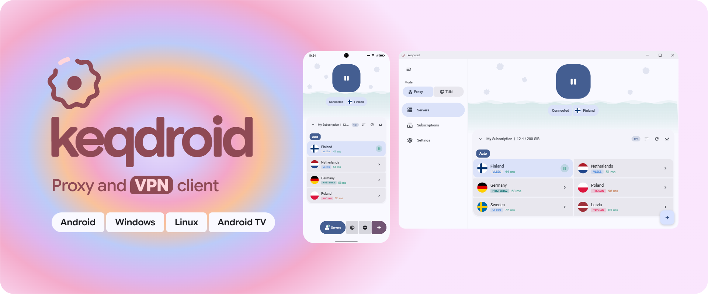

<p align="center" id="keqdroid">
  
</p>

<p align="center">˚ʚ♡ɞ˚</p>

<p align="center">
  <strong>English</strong> · <a href="#русский">Русский</a>
</p>

<p align="center">
  Proxy and VPN client: subscriptions, standalone configs, routing.
</p>

<p align="center">
  <a href="https://github.com/Lemonochka/keqdroid/releases"></a>
  <a href="https://github.com/Lemonochka/keqdroid/releases"></a>
  <a href="https://github.com/Lemonochka/keqdroid/actions/workflows/ci.yml"></a>
  <a href="LICENSE"></a>
  
  <a href="https://t.me/keqdroid"></a>
</p>

<p align="center">
  <a href="https://github.com/Lemonochka/keqdroid/releases"><strong>Download</strong></a>
  &nbsp;·&nbsp;
  <a href="https://t.me/keqdroid">Telegram chat</a>
  &nbsp;·&nbsp;
  <a href="docs/BUILD.md">Build from source</a>
</p>

---

## Download

Pre-built binaries are on [Releases](https://github.com/Lemonochka/keqdroid/releases).  
`SHA256SUMS` lists the hash of every file in the release; the built-in updater checks it before installing.

| Platform | Files in release |
|----------|------------------|
| **Android** 7.0+ | `keqdroid-<version>-android.apk` |
| **Android** 7.0+, 32-bit firmware | `keqdroid-<version>-armeabi-v7a-android.apk` |
| **Windows** x64 | `keqdroid-windows-x64-<version>.zip` (portable) |
| **Linux** x64 | `keqdroid-<version>-x86_64.AppImage` · `keqdroid_<version>_amd64.deb` · `keqdroid-<version>-1.x86_64.rpm` · `keqdroid-<version>-linux-x64.tar.gz` · `PKGBUILD` for Arch |

The app **does not provide servers**. Bring your own subscription or configs. Comply with the laws of your country.

---

## Features

**Servers and subscriptions**
- subscription URLs with scheduled auto-update; `keqdroid://` and `keqdis://` deep links from provider panels
- manual entry, config import, QR code scan (Android)
- proxy chains: traffic passes through several servers in the order you set
- **Auto** for a subscription: picks a steady server, moves on when it stops answering and goes back once it answers again; if the whole subscription goes silent while the one above or below it answers, moves there until its own answers again
- per-subscription device identity sent to the provider's panel
- checks: TCP, HTTP, ICMP, speed test; sorting by ping, name or speed

**Routing and tunnel**
- routes: block, direct, through the VPN or through another server, for all apps or chosen ones
- a route covers sites, IPs, ready-made lists (Russian sites, Iranian sites, ads and trackers, Re-filter, Russian mobile whitelists) or links to AdBlock and hosts lists, refreshed daily
- routing profiles: their own routes and Everything else for chosen subscriptions
- split tunnel: per-app on Android, per-program on Windows and Linux (TUN mode)
- **Connections**: active connections and the rule that matched each one
- after connecting, the flag of the country sites see you from; tap it for the exit IP

**Appearance and data**
- traffic speed and volume under the connect button, VPN and direct separately on mihomo
- color presets, dark and light, Material You palette on Android
- subscription cards with a palette or your own picture, carried over into that subscription's servers
- interface size from 70% to 140%: the whole interface scales, not just the text
- a phone in landscape or a tablet gets a navigation rail and a two-pane servers screen
- **About**: core versions, geo databases and the current session, copied as one report
- backup and restore: settings, servers, subscriptions with their images, split-tunnel lists
- share the local proxy over LAN
- hotkeys for connect/disconnect, TUN mode, best-ping server, show/hide window (system-wide on Windows, while the window is focused on Linux)
- English, Русский, Deutsch, 中文, فارسی
- updates from GitHub Releases

---

## Cores

Two cores run servers on every platform: **Xray** and **mihomo**. Each runs its own TUN mode. The core depends on the server:

| Server | Runs on |
|--------|---------|
| Links `vless://` `vmess://` `trojan://` `ss://` `hy2://` `socks://` | Xray or mihomo, your choice |
| `tuic://` `anytls://` `ssr://` `mierus://`, and links with a transport only mihomo has (for example HTTP/2 or a Shadowsocks plugin) | mihomo |
| Links with a transport only Xray has (for example mKCP, XHTTP for VMess and Trojan, finalmask) | Xray |
| Ready-made Xray config (`.json`) | Xray |
| Ready-made Clash / mihomo config | mihomo |
| Proxy chain | Xray or mihomo, your choice; a node only mihomo has (an AmneziaWG profile, for example) puts it on mihomo, a node only Xray has puts it on Xray |
| WireGuard / AmneziaWG profile | mihomo |

For links both cores support, pick the core in **Settings → About**; Xray is the default. A server only one core can run goes to that core whichever is picked, and **About** says so.

---

## Protocols

| Protocol | Link format / import |
|----------|----------------------|
| VLESS | `vless://` |
| VMess | `vmess://` |
| Trojan | `trojan://` |
| Shadowsocks | `ss://` |
| ShadowsocksR | `ssr://` |
| Hysteria 2 | `hysteria2://`, `hy2://` |
| TUIC | `tuic://` |
| AnyTLS | `anytls://` |
| Mieru | `mierus://` |
| SOCKS5 | `socks://`, `socks5://`, `socks5h://` |
| WireGuard / AmneziaWG | `.conf` profile; `wg://`, `awg://`, `wireguard://` links |
| Ready-made Xray config | whole `.json` (paste, file, subscription) |
| Ready-made Clash config | whole config (paste, file, subscription) |

Hysteria v1 links are not supported; a Hysteria v1 node in a Clash config runs on mihomo.

Clash and sing-box configs are split into servers, one per node, whether they come from a subscription, a file or a paste. A Clash config that can't be split (`proxy-providers`, unknown node types) is imported as one server and runs on mihomo as is. A node no link can describe (WireGuard and AmneziaWG, MASQUE, Snell, SSH and the like) or with settings a link can't carry (`ss-opts`, `smux`, a `dialer-proxy` chain, shadow-tls and the like) becomes a server of its own that runs on mihomo as is, so nothing it carries is lost.

A ready-made config keeps its own routing, DNS and outbound chains; only the inbounds are replaced. The server name comes from the root `remarks`. The app's routing lists apply only to traffic the config's own rules don't match. With "Ignore provider rules" on in Routing, the config's rules that send sites direct or block them, and its own catch-all, are dropped, so your routes and "Everything else" decide. Local network addresses always go direct.

A ready-made config can also be the server of a route: an Xray JSON when the connection runs on Xray, a Clash config when it runs on mihomo. The route gets the config's main outbound, or its first proxy group, with whatever these go through; the config's own rules and DNS stay out. A Clash config whose groups take nodes from `proxy-providers` or `include-all`, or drop them by name with `exclude-filter`, can't be a route server.

---

## Platforms

### Android

| Mode | What it does |
|------|--------------|
| **VPN** | Everything on the device goes through the tunnel. VPN permission on first connect. |
| **Proxy** | SOCKS and HTTP on `127.0.0.1`. Set it as the proxy in an app or in the Wi-Fi settings. |

Per-app routing and DNS interception work in VPN mode only. Connect and disconnect from the notification, the Quick Settings tile or launcher shortcuts. Subscriptions update in the background. A VPN that was on comes back after an app update or a phone restart.

On Android TV the app is driven by the remote. A subscription gets to the TV from keqdroid on a phone: the TV shows a QR code, the phone scans it and sends the subscription over the home Wi-Fi.

### Windows

| Mode | What it does |
|------|--------------|
| **Proxy** | System proxy for browsers and most apps. No administrator rights. |
| **TUN** | All traffic through a VPN adapter. Needs administrator rights; the app offers to restart with them. |

The window minimizes to the tray and remembers its size and position. Launch at system startup with optional auto-connect, and optionally straight to the tray without showing the window. Global hotkeys are in Settings → Advanced → Hotkeys. Subscriptions refresh while the app is open. After an in-app update the app reconnects if the VPN was on.

**Settings location:** `%APPDATA%\com.keqdroid\keqdroid\`, not next to the exe. To move to another PC, use backup and restore.

### Linux

Debian/Fedora/Arch, x86_64. Releases ship AppImage, deb, rpm and tar.gz. On Arch: `makepkg -si` with the `PKGBUILD` from the release.

| Mode | What it does |
|------|--------------|
| **Proxy** | No root |
| **TUN** | Root via `pkexec` (polkit) on connect; **Passwordless TUN** in Settings → Advanced → Permissions stops asking for the password |

The window remembers its size and position; hotkeys work while the app window is focused. Closing the window keeps the app in the tray, or minimizes it where there is no tray; Ctrl+Q quits. Start at login with optional auto-connect. After an in-app update the app reconnects if the VPN was on. Proxy mode sets the system proxy in GNOME and KDE settings, which Firefox reads on any desktop; elsewhere other apps need 127.0.0.1 and the port entered by hand.

---

## Getting started

1. **Subscriptions** — paste the URL, then «Add & Fetch».
2. **Servers** — pick a node.
3. Connect.
4. If needed — **Settings**: routing, split tunnel, hotkeys, connection mode.

---

## Development

Environment, per-platform builds, tests and releases: [`docs/BUILD.md`](docs/BUILD.md).

### Build

```bash
flutter pub get
flutter build apk --release      # Android
flutter build windows --release  # Windows
```

The Windows plugin list (`windows/flutter/app_plugins.cmake`) is committed without Firebase, which is Android-only. After adding or removing plugins, run `powershell -File tool/sync_windows_plugins.ps1`.

**Linux** builds on Linux or in WSL:

```bash
wsl -e bash /mnt/c/.../keqdroid/tool/build_linux_wsl.sh
# binary: build/linux/x64/release/bundle/keqdroid
```

The prebuilt cores are already in the repository: `assets/bin/windows/`, `assets/bin/linux/` and `android/app/src/main/jniLibs/`. How to rebuild them is in [`docs/BUILD.md`](docs/BUILD.md).

### Releases

```powershell
# Android + Windows + Linux (that part runs in WSL), SHA256SUMS, output to release\<version>\
powershell -ExecutionPolicy Bypass -File tool\make_release.ps1

# same + publish GitHub Release (requires gh CLI)
powershell -ExecutionPolicy Bypass -File tool\make_release.ps1 -Publish -NotesFile notes.md
```

Version and tag `vX.Y.Z` come from `pubspec.yaml`. When uploading manually, include `SHA256SUMS`, otherwise the updater won't install the update.

---

## Star history

<a href="https://www.star-history.com/#Lemonochka/keqdroid&Date">
  <picture>
    <source media="(prefers-color-scheme: dark)" srcset="https://api.star-history.com/svg?repos=Lemonochka/keqdroid&type=Date&theme=dark">
    <source media="(prefers-color-scheme: light)" srcset="https://api.star-history.com/svg?repos=Lemonochka/keqdroid&type=Date">
    
  </picture>
</a>

---

## License

[GPL-3.0](LICENSE). The bundled cores keep their upstream licenses: Xray-core (MPL-2.0), mihomo (GPL-3.0).

---

<h2 id="русский">Русский</h2>

<p align="center">˚ʚ♡ɞ˚</p>

<p align="center">
  <a href="#keqdroid">English</a> · <strong>Русский</strong>
</p>

<p align="center">
  Клиент прокси и VPN: подписки, отдельные конфиги, маршрутизация.<br>
  Android · Windows · Linux
</p>

<p align="center">
  <a href="https://github.com/Lemonochka/keqdroid/releases"></a>
  <a href="https://github.com/Lemonochka/keqdroid/releases"></a>
  <a href="https://github.com/Lemonochka/keqdroid/actions/workflows/ci.yml"></a>
  <a href="LICENSE"></a>
  
  <a href="https://t.me/keqdroid"></a>
</p>

<p align="center">
  <a href="https://github.com/Lemonochka/keqdroid/releases"><strong>Скачать</strong></a>
  &nbsp;·&nbsp;
  <a href="https://t.me/keqdroid">Чат в Telegram</a>
  &nbsp;·&nbsp;
  <a href="docs/BUILD.md#русский">Сборка из исходников</a>
</p>

---

## Скачать

Готовые сборки — в [Releases](https://github.com/Lemonochka/keqdroid/releases).  
Хеши всех файлов релиза лежат в `SHA256SUMS`, встроенный апдейтер сверяет их перед установкой.

| Платформа | Файлы в релизе |
|-----------|----------------|
| **Android** 7.0+ | `keqdroid-<версия>-android.apk` |
| **Android** 7.0+, 32-битная прошивка | `keqdroid-<версия>-armeabi-v7a-android.apk` |
| **Windows** x64 | `keqdroid-windows-x64-<версия>.zip` (portable) |
| **Linux** x64 | `keqdroid-<версия>-x86_64.AppImage` · `keqdroid_<версия>_amd64.deb` · `keqdroid-<версия>-1.x86_64.rpm` · `keqdroid-<версия>-linux-x64.tar.gz` · `PKGBUILD` для Arch |

Приложение **не раздаёт серверы** — нужна своя подписка или конфиги. Соблюдайте законы вашей страны.

---

## Возможности

**Серверы и подписки**
- подписки по URL с автообновлением по расписанию; deep-ссылки `keqdroid://` и `keqdis://` из панелей провайдеров
- ручное добавление, импорт конфигов, сканирование QR-кодов (Android)
- цепочки прокси: трафик проходит через несколько серверов в заданном порядке
- **Auto** у подписки: выбирает стабильный сервер, уходит с него, когда он перестаёт отвечать, и возвращается, когда он снова отвечает; если молчит вся подписка, а соседняя выше или ниже отвечает, переходит туда, пока своя снова не ответит
- отдельные данные устройства для каждой подписки (их видит панель провайдера)
- проверки: TCP, HTTP, ICMP, тест скорости; сортировка по пингу, имени или скорости

**Маршрутизация и туннель**
- маршруты: блокировать, напрямую, через VPN или через другой сервер, для всех приложений или выбранных
- маршрут охватывает сайты, IP, готовые списки («Российские сайты», «Иранские сайты», «Реклама и трекеры», Re-filter, «Белые списки мобильной связи») или ссылки на списки AdBlock и hosts, которые обновляются раз в сутки
- профили маршрутизации: свои маршруты и «Всё остальное» для выбранных подписок
- split tunnel: на Android по приложениям, на Windows и Linux по программам (режим TUN)
- **Соединения**: активные соединения и правило, которое сработало для каждого
- после подключения флаг страны, из которой вас видят сайты; по нажатию IP выхода

**Оформление и данные**
- скорость и объём трафика под кнопкой подключения, на mihomo отдельно для VPN и для прямых соединений
- цветовые пресеты, тёмная и светлая тема, палитра Material You на Android
- карточки подписок с палитрой или своей картинкой, оформление переносится на их серверы
- размер интерфейса от 70% до 140%: меняется весь интерфейс, а не только текст
- на телефоне боком и на планшете — навигационная рейка и экран серверов в две панели
- **О приложении**: версии ядер, geo-базы и текущая сессия одним отчётом
- резервная копия и восстановление: настройки, серверы, подписки вместе с их картинками, списки split tunnel
- раздача локального прокси в локальную сеть
- хоткеи на подключение, режим TUN, сервер с лучшим пингом, показать/скрыть окно — глобальные на Windows, в фокусе окна на Linux
- English, Русский, Deutsch, 中文, فارسی
- обновление из GitHub Releases

---

## Ядра

На всех платформах серверы работают на двух ядрах: **Xray** и **mihomo**. Режим TUN у каждого свой. Ядро зависит от сервера:

| Сервер | Исполняет |
|--------|-----------|
| Ссылки `vless://` `vmess://` `trojan://` `ss://` `hy2://` `socks://` | Xray или mihomo — на выбор |
| `tuic://` `anytls://` `ssr://` `mierus://` и ссылки с транспортом, который есть только у mihomo (например, HTTP/2 или плагин Shadowsocks) | mihomo |
| Ссылки с транспортом, который есть только у Xray (например, mKCP, XHTTP у VMess и Trojan, finalmask) | Xray |
| Готовый конфиг Xray (`.json`) | Xray |
| Готовый конфиг Clash / mihomo | mihomo |
| Цепочка прокси | Xray или mihomo, на выбор; узел, который есть только у mihomo (например, профиль AmneziaWG), ведёт её на mihomo, а узел только для Xray ведёт на Xray |
| Профиль WireGuard / AmneziaWG | mihomo |

Для ссылок, которые поддерживают оба ядра, ядро выбирается в **Настройки → О приложении**; по умолчанию Xray. Сервер, который умеет только одно ядро, идёт на нём при любом выборе, и **О приложении** об этом пишет.

---

## Протоколы

| Протокол | Формат ссылки / импорт |
|----------|------------------------|
| VLESS | `vless://` |
| VMess | `vmess://` |
| Trojan | `trojan://` |
| Shadowsocks | `ss://` |
| ShadowsocksR | `ssr://` |
| Hysteria 2 | `hysteria2://`, `hy2://` |
| TUIC | `tuic://` |
| AnyTLS | `anytls://` |
| Mieru | `mierus://` |
| SOCKS5 | `socks://`, `socks5://`, `socks5h://` |
| WireGuard / AmneziaWG | профиль `.conf`; ссылки `wg://`, `awg://`, `wireguard://` |
| Готовый конфиг Xray | `.json` целиком (вставка, файл, подписка) |
| Готовый конфиг Clash | конфиг целиком (вставка, файл, подписка) |

Ссылки Hysteria v1 не поддерживаются; узел Hysteria v1 в конфиге Clash работает на mihomo.

Конфиги Clash и sing-box раскладываются на серверы, по одному на узел, откуда бы они ни пришли: из подписки, файла или вставки. Конфиг Clash, который разложить нельзя (`proxy-providers`, неизвестные типы узлов), импортируется одним сервером и работает на mihomo как есть. Узел, который ссылкой не записать (WireGuard и AmneziaWG, MASQUE, Snell, SSH и подобные), или с настройками, которые ссылка не передаёт (`ss-opts`, `smux`, цепочка `dialer-proxy`, shadow-tls и подобные), становится отдельным сервером и работает на mihomo как есть, без потерь.

Готовый конфиг сохраняет свою маршрутизацию, DNS и цепочки аутбаундов, заменяются только инбаунды. Имя сервера берётся из корневого `remarks`. Списки маршрутизации приложения применяются только к трафику, который не поймали правила самого конфига. Переключатель «Не учитывать правила провайдера» в «Маршрутизации» убирает правила конфига, которые пускают сайты напрямую или блокируют их, и его собственное «всё остальное», и тогда решают ваши маршруты и «Всё остальное». Локальная сеть всегда идёт напрямую.

Готовый конфиг может быть и сервером маршрута: JSON Xray, когда подключение идёт через Xray, конфиг Clash, когда через mihomo. В маршрут попадает главный аутбаунд конфига или его первая группа вместе с тем, через что они ходят, а правила и DNS самого конфига остаются за бортом. Конфиг Clash, чьи группы набирают узлы из `proxy-providers` или через `include-all` либо отсеивают их по имени через `exclude-filter`, сервером маршрута быть не может.

---

## Платформы

### Android

| Режим | Что делает |
|-------|------------|
| **VPN** | Через туннель идёт всё устройство. При первом подключении — разрешение VPN. |
| **Proxy** | SOCKS и HTTP на `127.0.0.1`. Прокси нужно указать в программе или в настройках Wi-Fi. |

Маршрутизация по приложениям и перехват DNS работают только в режиме VPN. Подключаться и отключаться можно из уведомления, плитки в быстрых настройках и ярлыков на значке приложения. Подписки обновляются в фоне. Если VPN был включён, после обновления приложения или перезагрузки телефона он поднимается сам.

На Android TV приложением управляют пультом. Подписка попадает на телевизор из keqdroid на телефоне: телевизор показывает QR-код, телефон сканирует его и отправляет подписку по домашнему Wi-Fi.

### Windows

| Режим | Что делает |
|-------|------------|
| **Proxy** | Системный прокси — браузеры и большинство программ. Без прав администратора. |
| **TUN** | Весь трафик через VPN-адаптер. Нужны права администратора — приложение предложит перезапуститься с ними. |

Окно сворачивается в трей и запоминает свой размер и позицию. Автозапуск вместе с системой, при желании с автоподключением и сразу в трей, без окна. Глобальные хоткеи — в Настройки → Дополнительно → Горячие клавиши. Подписки обновляются, пока приложение открыто. После обновления из приложения оно переподключается, если VPN был включён.

**Где лежат настройки:** `%APPDATA%\com.keqdroid\keqdroid\`, не в папке с exe. Для переноса на другой ПК есть резервная копия и восстановление.

### Linux

Debian/Fedora/Arch, x86_64. В релизе есть AppImage, deb, rpm и tar.gz. Для Arch: `makepkg -si` с `PKGBUILD` из релиза.

| Режим | Что делает |
|-------|------------|
| **Proxy** | Без root |
| **TUN** | Root через `pkexec` (polkit) при подключении; **TUN без пароля** в Настройки → Дополнительно → Разрешения перестаёт его спрашивать |

Окно запоминает размер и позицию; хоткеи работают, пока окно приложения в фокусе. Крестик оставляет приложение в трее, а где трея нет, сворачивает окно; Ctrl+Q закрывает приложение. Запуск при входе в систему, при желании с автоподключением. После обновления из приложения оно переподключается, если VPN был включён. В режиме Proxy системный прокси прописывается в настройки GNOME и KDE, их читает Firefox в любой среде; в остальных средах другим программам 127.0.0.1 и порт указывают вручную.

---

## Начало работы

1. **Подписки** — вставить URL, затем «Добавить и загрузить».
2. **Серверы** — выбрать узел.
3. Подключиться.
4. При необходимости — **Настройки**: маршрутизация, split tunnel, хоткеи, режим подключения.

---

## Разработка

Окружение, сборка под каждую платформу, тесты и релизы — [`docs/BUILD.md`](docs/BUILD.md#русский).

### Сборка

```bash
flutter pub get
flutter build apk --release      # Android
flutter build windows --release  # Windows
```

Список Windows-плагинов (`windows/flutter/app_plugins.cmake`) лежит в репозитории без Firebase, который нужен только на Android. После добавления или удаления плагинов запустите `powershell -File tool/sync_windows_plugins.ps1`.

**Linux** собирается только на Linux или в WSL:

```bash
wsl -e bash /mnt/c/.../keqdroid/tool/build_linux_wsl.sh
# бинарь: build/linux/x64/release/bundle/keqdroid
```

Собранные ядра уже лежат в репозитории: `assets/bin/windows/`, `assets/bin/linux/` и `android/app/src/main/jniLibs/`. Как их пересобрать — в [`docs/BUILD.md`](docs/BUILD.md#русский).

### Релизы

```powershell
# Android + Windows + Linux (эта часть — в WSL), SHA256SUMS, папка release\<версия>\
powershell -ExecutionPolicy Bypass -File tool\make_release.ps1

# то же + GitHub Release (нужен gh CLI)
powershell -ExecutionPolicy Bypass -File tool\make_release.ps1 -Publish -NotesFile notes.md
```

Версия и тег `vX.Y.Z` берутся из `pubspec.yaml`. При ручной загрузке добавьте `SHA256SUMS`, иначе апдейтер не установит обновление.

---

## История звёзд

<a href="https://www.star-history.com/#Lemonochka/keqdroid&Date">
  <picture>
    <source media="(prefers-color-scheme: dark)" srcset="https://api.star-history.com/svg?repos=Lemonochka/keqdroid&type=Date&theme=dark">
    <source media="(prefers-color-scheme: light)" srcset="https://api.star-history.com/svg?repos=Lemonochka/keqdroid&type=Date">
    
  </picture>
</a>

---

## Лицензия

[GPL-3.0](LICENSE). Встроенные ядра — под своими лицензиями: Xray-core (MPL-2.0), mihomo (GPL-3.0).

---

<p align="center">✦ ˚ · . &nbsp; ˚ʚ♡ɞ˚ &nbsp; . · ˚ ✦</p>
<p align="center"><sub>made with ♡ · Flutter + Xray + mihomo</sub></p>
